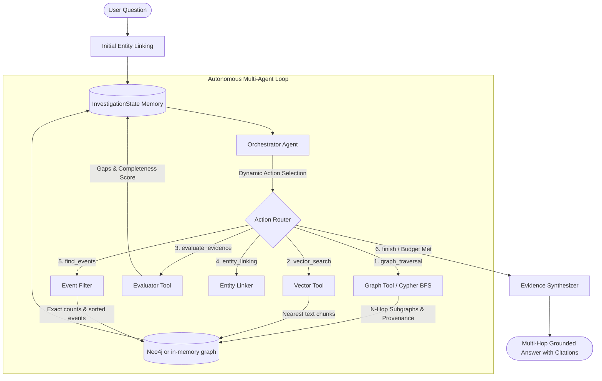

# GraphScout 🧭⚡
> **Autonomous Agentic GraphRAG on Neo4j**

---

## 🌟 Summary

**GraphScout** is an autonomous multi-agent GraphRAG system. It answers complex, multi-hop questions over a knowledge graph combined with a vector index.

It doesn't rely on a single vector search or a fixed subgraph. Instead, an **Orchestrator Agent** keeps a working hypothesis and chooses its next step each round. The options are:

- **Multi-hop graph traversal.**
- **Vector similarity search** over text chunks.
- **Structured event filtering:** exact counts and rankings over every Olympic event.
- **Evidence completeness evaluation.**

It keeps going, resolving contradictions and filling knowledge gaps, until it has enough evidence or runs out of budget.

The graph lives in **Neo4j** (for example a free Neo4j AuraDB instance). With no Neo4j configured, the same graph runs in an **in-memory engine** built from the corpus at start-up, so the app works with zero setup.

---

## 🏛️ System Architecture



### Graph model

| Element | Neo4j | Meaning |
|---|---|---|
| `(:Entity)` | key `entity_id` | Olympic events, venues, Games, gold medallists |
| `(:Chunk)` | key `chunk_id`, `embedding` in a vector index | A document's text passage |
| `(:Entity)-[:RELATED_TO {relation_type}]->(:Entity)` | `HELD_AT`, `PART_OF_GAMES`, `WON_GOLD` | Multi-hop backbone |
| `(:Chunk)-[:MENTIONS]->(:Entity)` | | Provenance: which text backs which entity |

Each Olympic event entity also stores its infobox fields: sport, Games (year and season), venue, date, number of competitors, number of nations and gold medallist.

### Why `find_events` exists
Text search and graph walks only ever return a sample. The vector search keeps the top few chunks, and a traversal keeps at most 15 neighbours of a hub like "2008 Summer Olympics". Questions that need **every** matching event can't be answered from a sample:

- How many events had more than N competitors?
- Which event had the most competitors?
- Who won at the Games held immediately before YEAR?
- What was held at VENUE on DATE?

`find_events` filters all events on those fields and returns the exact match count plus sorted rows. The rules live in one place, [backend/src/db/events.py](backend/src/db/events.py), so both backends return identical results.

Indexes and constraints are created automatically on connect. The full Cypher is in [backend/src/db/neo4j_client.py](backend/src/db/neo4j_client.py) and on the app's **Schema** tab.

---

## 📊 3-Way Benchmarking Suite

1. **Standard RAG** (`src/pipelines/standard_rag.py`): vector search over chunks, then a single-pass answer.
2. **GraphRAG** (`src/pipelines/graph_rag.py`): single pass combining the entities' 1-hop neighbourhood with the top vector chunks.
3. **Agentic GraphRAG** (`src/pipelines/agentic_rag.py`): the multi-step investigation loop, including `find_events`. The two baselines deliberately don't get it.

### Evaluation Metrics
- **Accuracy Score**: 1.0 if a ground-truth answer appears in the generated answer, otherwise best token-F1 against the references (`src/evaluation/metrics.py`).
- **Answer Completeness**: context recall, the share of ground-truth answer tokens present in the evidence each pipeline retrieved.
- Both scores are `null` / `n/a` for questions without ground truth (e.g. `eval_hidden.jsonl`). The agentic pipeline also reports its evaluator's `self_assessed_completeness`, which is not ground-truth based.
- **Token Efficiency**: prompt and completion tokens and cost.
- **Execution Latency**: end-to-end response time.

---

## 📂 Repository Layout

```
GraphScout/
├── backend/                       # Python FastAPI backend
│   ├── src/
│   │   ├── agents/
│   │   │   ├── state.py           # InvestigationState & Pydantic memory schema
│   │   │   ├── orchestrator.py    # Autonomous multi-hop reasoning & decision engine
│   │   │   └── tools/             # graph_tool, vector_tool, evaluator_tool
│   │   ├── db/
│   │   │   ├── graph_client.py    # Backend interface + factory (GRAPH_BACKEND)
│   │   │   ├── neo4j_client.py    # Neo4j backend (Cypher, vector index)
│   │   │   ├── memory_graph.py    # In-memory backend (no setup)
│   │   │   ├── events.py          # Event attributes + find_events filter rules
│   │   │   └── ingest_corpus.py   # Document → graph records; ingestion CLI
│   │   ├── pipelines/             # standard_rag, graph_rag, agentic_rag
│   │   ├── evaluation/            # benchmark_runner, metrics
│   │   ├── web/api.py             # FastAPI REST endpoints
│   │   └── utils/                 # llm_client, embeddings, env
│   ├── tests/                     # pytest suite (runs offline)
│   ├── server.py                  # Uvicorn launcher
│   ├── main.py                    # CLI for queries & benchmarks
│   └── requirements.txt
├── frontend/                      # Next.js 14 web app
│   ├── app/                       # layout.tsx, page.tsx, globals.css
│   ├── components/                # Studio, KnowledgeGraph, StepTraces, BenchmarkSuite,
│   │                              # CorpusExplorer, DocumentModal, SchemaView, …
│   └── lib/                       # Typed API client & types
├── configs/config.yaml            # Reference only (not read at runtime)
├── data/
│   ├── documents/corpus.jsonl     # 2,951 Olympic event documents
│   ├── eval_public.jsonl          # 100 benchmark questions with answers
│   ├── eval_hidden.jsonl          # 50 questions without answers
│   └── benchmark_questions.json   # Sample test questions
└── run.py                         # Starts backend + frontend together
```

---

## 🚀 Quickstart

### 1. Install dependencies
```powershell
.venv\Scripts\activate
pip install -r backend\requirements.txt

cd frontend && npm install && cd ..
```

### 2. Configure (`backend/.env`, git-ignored)
Environment variables work too. `configs/config.yaml` is reference only.

```ini
# LLM: set ONE (OpenAI wins if both are set; force with LLM_PROVIDER=groq|openai)
GROQ_API_KEY=your-groq-key        # free tier works; default model openai/gpt-oss-120b
# OPENAI_API_KEY=your-openai-key  # default model gpt-4o
# LLM_MODEL=openai/gpt-oss-20b    # optional override

# Graph database: leave NEO4J_URI out to use the in-memory graph
NEO4J_URI=neo4j+s://<instance-id>.databases.neo4j.io
NEO4J_USERNAME=neo4j
NEO4J_PASSWORD=your-password
NEO4J_DATABASE=neo4j
# GRAPH_BACKEND=auto              # auto (default) | neo4j (fail if unreachable) | memory
```

Without any LLM key the app runs in **offline simulation mode**: decisions and answers are canned demo responses, so answers and benchmark scores are not meaningful.

Vector search uses a built-in hashed bag-of-words embedder (`src/utils/embeddings.py`) for both stored chunks and queries. It is free and works with any LLM provider, but it matches words rather than meaning.

### 3. Set up Neo4j (optional, one-time)
1. Create a free instance at [Neo4j AuraDB](https://console.neo4j.io). Save the credentials file it offers; its `NEO4J_*` lines go straight into `backend/.env`.
2. Wait until the instance shows **Running**, then load the corpus:
   ```powershell
   cd backend
   ..\.venv\Scripts\python -m src.db.ingest_corpus --all
   ```
   This takes about a minute and is safe to re-run (writes are upserts). Indexes are created automatically. Re-run it after changing how documents become graph records (`src/db/ingest_corpus.py`, `src/db/events.py`).
3. Start the app. The sidebar shows **Neo4j** with entity, relationship and chunk counts.

If `NEO4J_URI` is set but Neo4j is unreachable, the backend logs an error and falls back to the in-memory graph. Set `GRAPH_BACKEND=neo4j` to make that a hard failure instead.

On a free tier with no activity, Aura may pause the instance. Resume it from the Aura console.

### 4. Launch (backend + frontend)
```powershell
python run.py
```
If port 3000 or 8000 is already taken (by another app or a GraphScout that didn't shut down), `run.py` stops with a message saying which port. Ctrl+C stops both servers.
- 🌐 **Frontend**: [http://localhost:3000](http://localhost:3000)
- ⚡ **API**: [http://localhost:8000](http://localhost:8000) · Swagger docs at [/docs](http://localhost:8000/docs)

Web interface:
- **Investigation Studio**: interactive knowledge-graph canvas, step-by-step trace, grounded answers with citations, supporting passages.
- **Benchmark Suite**: Standard RAG vs GraphRAG vs Agentic GraphRAG, with charts and JSON/CSV export.
- **Corpus Explorer**: search the 2,951 Olympic event documents.
- **Schema**: node and relationship types plus the Cypher the backend runs.

### 5. Run pieces individually
```powershell
cd backend && ..\.venv\Scripts\python server.py   # backend only (port 8000)
cd frontend && npm run dev                         # frontend only (port 3000)
```

### 6. CLI investigation and benchmark
```powershell
cd backend
..\.venv\Scripts\python main.py --query "Who won the gold medal in the event held at Eton Dorney on 6 to 8 August at the 2012 Summer Olympics?"
..\.venv\Scripts\python main.py --benchmark
```

### 7. Tests
```powershell
cd backend && ..\.venv\Scripts\pytest
```
Tests always run offline on the in-memory graph, even if `backend/.env` configures Neo4j or an LLM key.
