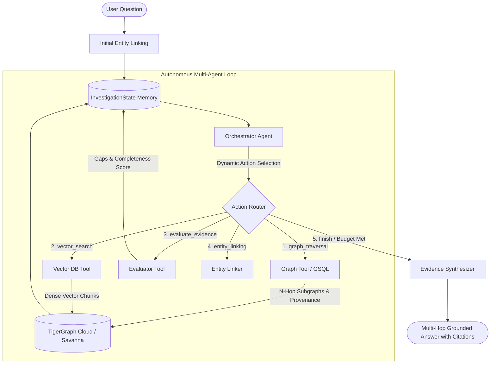

# GraphScout 🧭⚡
> **Autonomous Agentic GraphRAG System on TigerGraph**
> *TigerGraph Agentic GraphRAG Hackathon Submission*

---

## 🌟 Executive Summary

**GraphScout** is an autonomous multi-agent GraphRAG architecture that investigates complex, multi-hop, and uncertain queries over TigerGraph's hybrid Graph + Vector database. 

Instead of relying on rigid, single-pass vector searches or static subgraphs, GraphScout deploys an **Orchestrator Agent** with a working hypothesis memory harness. The orchestrator dynamically routes between **GSQL multi-hop graph traversals**, **dense vector similarity retrieval**, and **evidence completeness evaluation**, resolving contradictions and filling knowledge gaps until conclusive stopping conditions are met.

---

## 🏛️ System Architecture



---

## 📊 3-Way Benchmarking Suite

GraphScout includes an automated benchmarking harness executing side-by-side evaluations across the required 3 paradigms:

1. **Standard RAG** (`src/pipelines/standard_rag.py`): Pure dense vector search over chunk embeddings + single-pass generation.
2. **GraphRAG** (`src/pipelines/graph_rag.py`): Single-pass hybrid search combining 1-hop entity neighborhood graph + top vector chunks.
3. **Agentic GraphRAG** (`src/pipelines/agentic_rag.py`): GraphScout multi-step autonomous investigation loop with dynamic gap closure.

### Evaluation Metrics
- **Accuracy Score**: Ground truth alignment and factual consistency.
- **Answer Completeness**: Percentage of required multi-hop facts gathered.
- **Token Efficiency**: Prompt and completion token consumption and cost.
- **Execution Latency**: End-to-end response time.

---

## 📂 Repository Directory Layout

```
GraphScout/
├── backend/                       # Python FastAPI Backend
│   ├── src/
│   │   ├── agents/
│   │   │   ├── state.py           # InvestigationState & Pydantic v2 memory schema
│   │   │   ├── orchestrator.py    # Autonomous multi-hop reasoning & decision engine
│   │   │   └── tools/             # Specialized sub-agent tools
│   │   │       ├── graph_tool.py  # TigerGraph GSQL multi-hop traversals
│   │   │       ├── vector_tool.py # TigerGraph dense vector chunk search
│   │   │       └── evaluator_tool.py
│   │   ├── db/
│   │   │   ├── tigergraph_client.py  # pyTigerGraph client with offline mock
│   │   │   └── ingest_corpus.py      # Corpus → graph ingestion pipeline
│   │   ├── pipelines/
│   │   │   ├── standard_rag.py    # Baseline vector-only RAG
│   │   │   ├── graph_rag.py       # Static 1-pass GraphRAG
│   │   │   └── agentic_rag.py     # GraphScout agentic wrapper
│   │   ├── evaluation/
│   │   │   └── benchmark_runner.py # 3-way evaluation runner & JSON reporter
│   │   ├── web/
│   │   │   └── api.py             # FastAPI REST endpoints (CORS-enabled)
│   │   └── utils/
│   │       └── llm_client.py      # Structured output parser, embeddings & tokens
│   ├── tests/
│   │   ├── test_graphscout.py     # Core engine pytest suite (4 tests)
│   │   └── test_web_api.py        # Web API pytest suite (7 tests)
│   ├── server.py                  # Uvicorn launcher (python server.py)
│   ├── main.py                    # CLI runner for queries & benchmarks
│   ├── requirements.txt           # Python dependencies
│   └── pytest.ini                 # Test configuration
├── frontend/                      # Next.js 14 Web Application
│   ├── app/                       # App Router (layout.tsx, page.tsx, globals.css)
│   ├── components/                # Modular React UI & Visualizations
│   │   ├── Navbar.tsx
│   │   ├── Sidebar.tsx
│   │   ├── InvestigationStudio.tsx
│   │   ├── KnowledgeGraph.tsx     # Interactive Vis-Network Graph
│   │   ├── StepTraces.tsx         # Audit Step Timeline
│   │   ├── DocumentChunks.tsx     # Vector Passages
│   │   ├── BenchmarkSuite.tsx     # Chart.js Evaluation Analytics
│   │   ├── CorpusExplorer.tsx     # 2,951 Document Browser
│   │   ├── DocumentModal.tsx      # Infobox & Text Drawer
│   │   └── GsqlSchemaView.tsx     # GSQL Schema Viewer
│   ├── lib/                       # Typed API Client & Types
│   ├── next.config.mjs            # Next.js Config & API Rewrites Proxy
│   ├── tailwind.config.ts         # Tailwind Styling Config
│   └── package.json
├── configs/
│   └── config.yaml                # TigerGraph, Vector DB, and LLM hyperparameters
├── data/
│   ├── documents/corpus.jsonl     # 2,951 Olympic event documents
│   ├── eval_public.jsonl          # 100 benchmark questions
│   ├── eval_hidden.jsonl          # 50 hidden evaluation questions
│   └── benchmark_questions.json   # Sample test questions
├── schema/
│   └── graph_schema.gsql          # GSQL Schema (Document, Chunk, Entity, Event)
├── run.py                         # Unified launcher (backend + frontend)
├── .gitignore
└── README.md
```

---

## 🚀 Quickstart Guide

### 1. Install Dependencies
```powershell
# Python backend
.venv\Scripts\activate
pip install -r backend\requirements.txt

# Next.js frontend
cd frontend && npm install && cd ..
```

### 2. Configure Credentials
Set your TigerGraph Cloud instance and OpenAI API credentials in `configs/config.yaml` or via environment variables:
```powershell
$env:OPENAI_API_KEY="your-openai-api-key"
$env:TIGERGRAPH_HOST="https://your-instance.i.tgcloud.io"
$env:TIGERGRAPH_PASSWORD="your-password"
$env:TIGERGRAPH_SECRET="your-secret"
```

### 3. Launch Full-Stack (Backend + Frontend)
```powershell
python run.py
```
This concurrently starts:
- 🌐 **Next.js Frontend**: **[http://localhost:3000](http://localhost:3000)**
- ⚡ **FastAPI REST Backend**: **[http://localhost:8000](http://localhost:8000)**
- 📑 **Interactive OpenAPI Swagger Docs**: **[http://localhost:8000/docs](http://localhost:8000/docs)**

#### Next.js Web Interface Capabilities:
- **Investigation Studio**: Interactive force-directed Knowledge Graph canvas (Vis-Network), real-time step traces timeline, grounded answers with citations, supporting document passages.
- **3-Way Benchmark Suite**: Side-by-side comparative analytics (Standard RAG vs GraphRAG vs Agentic GraphRAG) powered by Chart.js with downloadable JSON/CSV reports.
- **Corpus Explorer**: Instant search across 2,951 Olympic event documents with infobox extraction.
- **TigerGraph GSQL Blueprint**: Schema visualizer and query definitions.

### 4. Run Backend or Frontend Individually
```powershell
# Backend only (port 8000)
cd backend && ..\.venv\Scripts\python server.py

# Frontend only (port 3000)
cd frontend && npm run dev
```

### 5. Run Autonomous Agent Investigation via CLI
```powershell
cd backend && ..\.venv\Scripts\python main.py --query "Who won the gold medal in the event held at Eton Dorney on 6 to 8 August at the 2012 Summer Olympics?"
```

### 6. Run 3-Way Benchmark Suite via CLI
```powershell
cd backend && ..\.venv\Scripts\python main.py --benchmark
```

### 7. Run Unit Tests
```powershell
cd backend && ..\.venv\Scripts\pytest
```